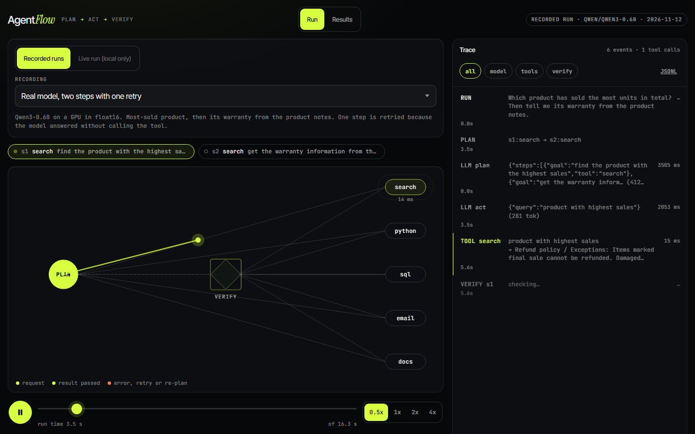
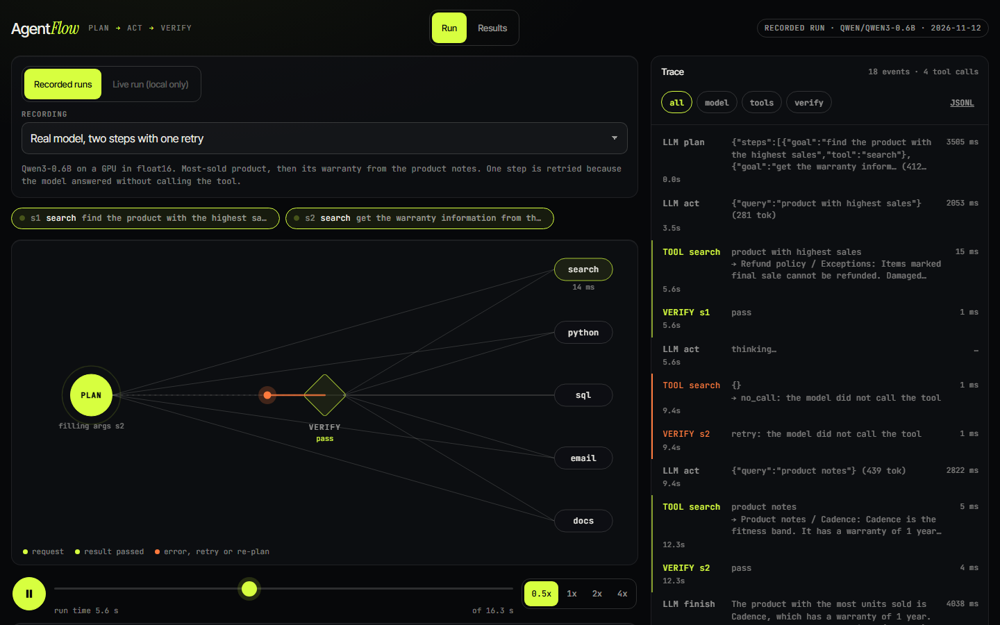
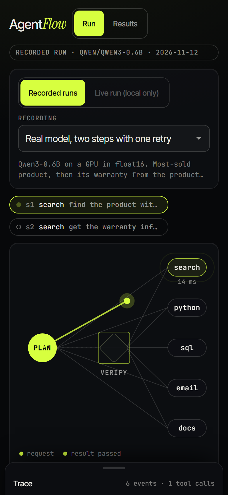
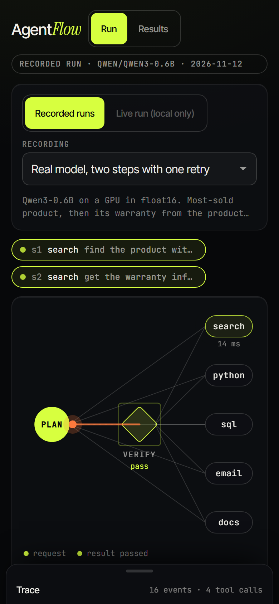
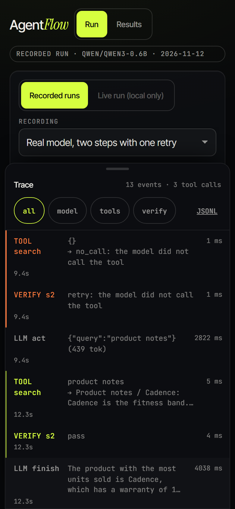
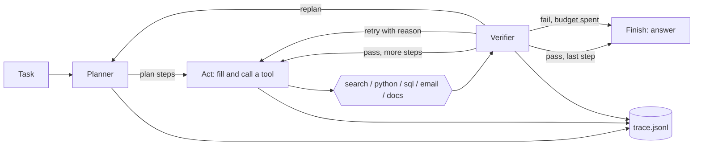
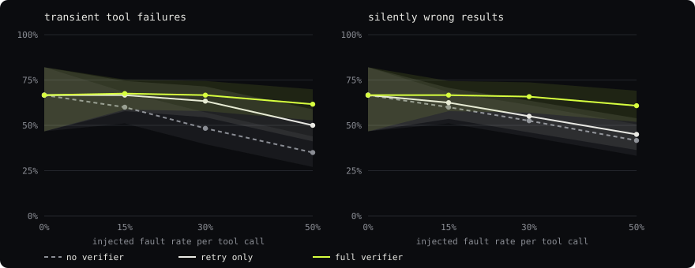

# AgentFlow

[](https://github.com/Aditya2616/AgentFlow/actions/workflows/ci.yml) [](LICENSE)

An agent that plans a multi-step task, calls tools and checks each result before it moves on. The loop is
**plan, act, verify**, built as a [LangGraph](https://docs.langchain.com/oss/python/langgraph) state graph with five
tools (search, Python, SQL, email, documents), a JSONL trace of every call, and a live graph UI where you can watch
a request travel from the planner to a tool, through the verifier and back.

It runs fully offline with a small open model (Qwen3-0.6B), on a CPU or a GPU. OpenAI and Anthropic adapters exist behind the
same interface. I wrote this to see how much a deterministic verifier can rescue a very small model, and I report the
measured answer below, including the parts that did not work.

**Static demo (replays recorded runs, no backend):** `docs/` is a plain static site, ready for GitHub Pages.
Every run it shows is a real trace produced by this code, labelled as recorded.



A retry in motion: when a result fails its check the verifier sends an orange packet back toward the planner, and the trace shows the reason.



<p>



</p>

## What is real and what is not

| Path | Status |
|---|---|
| Local model (Qwen3-0.6B), five tools, graph, SSE server, UI, trace, evaluation | Run for real on my PC. The evaluation numbers come from a GPU run in float16; the CPU path (bfloat16) is exercised by the fast tests and a few early runs, not by the published numbers. |
| Scripted model (deterministic replay of a plan, with optional deliberate mistakes) | Used for tests, CI and the "mechanics" recordings. Labelled "scripted" everywhere. It is not a model result. |
| OpenAI and Anthropic adapters | Written as LangChain chat models over `httpx`, tested **only** against `httpx.MockTransport` stubs. I had no API keys, so they have never talked to the real services. |
| Qwen2.5-1.5B-Instruct (`local-large`) | Run for real: the clean suite in all three arms and one fault cell (30% silent faults). Not part of the rest of the fault experiments. |

## How it works



* **Planner**: the model writes a short JSON plan (`goal` and `tool` per step). Output is parsed with pydantic, one
  repair attempt, then a single-step fallback plan.
* **Act**: a tool-bound model call fills in the arguments, seeing the results of earlier steps. This works better for a
  0.6B model than asking it to write every argument up front.
* **Verifier**: deterministic, no model. Its checks are simple: the tool did not raise; search returned hits and the
  best score is at least 0.8; SQL returned rows with no NULL in the first three; Python printed something; a document read is not
  empty and is as long as the document's stated length (up to the tool's size cap); an email body repeats at least one fact from the earlier results and goes to an address the request names.
  Outcomes are `pass`, `retry` (with the reason fed back), `replan` or `fail`.
* **Budgets**: 3 tries per step, 2 re-plans, a hard cap on acts. Running out gives an honest `fail` with partial results.
* **Trace**: one JSON line per span start and end, attribute names aligned with the
  [OpenTelemetry GenAI conventions](https://opentelemetry.io/docs/specs/semconv/gen-ai/) (still marked experimental;
  I say "aligned with", not "compliant"). One tracer feeds the CLI, the SSE stream and the replay UI.
  Format in [docs/notes/TRACE_FORMAT.md](docs/notes/TRACE_FORMAT.md).

### Tools

| Tool | Behaviour |
|---|---|
| `search` | BM25 over the bundled documents (own implementation), optional MiniLM hybrid via reciprocal rank fusion |
| `python` | Runs code in a separate process behind several best-effort layers (see the sandbox section) |
| `sql` | SQLite opened read-only at the connection level (`mode=ro` plus `PRAGMA query_only`), one SELECT or WITH statement, row cap, time limit |
| `email` | Writes an `.eml` file and a JSONL entry to `outbox/`. Real SMTP only if `AGENTFLOW_SMTP_URL` is set **and** `AGENTFLOW_ALLOW_SEND=1`; a test checks that the URL alone does not send |
| `docs` | Read or extractively summarise files under the bundled corpus, with path traversal blocked |

## Results

<!-- RESULTS:START -->
Everything in this section is generated by `scripts/check_numbers.py` from the result files in `evals/results/`, and a fast
test fails if the README disagrees with them. Unless a heading says otherwise, the numbers are Qwen3-0.6B on a GPU in
float16 (device: cuda; the GPU was only a speed choice and the code runs the same on a CPU), the 24-task
suite, greedy decoding. Model replies are cached by prompt, so the three arms share replies wherever their prompts match,
which makes **model calls** the fair cost measure here, not wall-clock seconds. Reproduce with
`agentflow ablate --rates 0,0.15,0.3,0.5 --seeds 5` followed by `agentflow eval-report`. Files:
`evals/results/dose/*.json` (one per cell), `DOSE.md` (full tables with the paired tests), `FAILURES.md`, `SUMMARY.md`.

**Three arms.** *No verifier*: every result is passed on unchecked. *Retry only*: a tool call that raises is retried
with the error text (the same limit of 3 tries), but nothing else is checked and there is no re-plan; when the
retries run out the run fails. *Full verifier*: result checks, retries and re-plans, plus the email send guard.

**Two kinds of injected fault.** *Transient*: the tool call raises a timeout. *Silent*: the tool succeeds but returns a
well-formed wrong result (no search hits, zero SQL rows, empty Python output, or a document read cut to 40 characters while
its stated length stays the same). Rates are per tool call, and each (task, seed) pair has its own seeded fault stream. Rate
0 is one run per arm (greedy decoding makes the seeds identical); the other rates are 24 tasks x 5 seeds =
120 runs per arm.

**How a task is scored.** Each task has a checker that tests behaviour: the right value in the answer, or the right email,
and for the three tasks that must be refused, that nothing was changed or leaked and that the run did not claim to have
done it. Two rules apply to every task: the database is unchanged, and any email goes to an address the request names.



The same chart, drawn from `results.json`, is the Results tab of the UI.

**transient tool failures** (success with its 95% Wilson interval; mean model calls per task in brackets)

| fault rate | runs per arm | no verifier | retry only | full verifier |
|---|---|---|---|---|
| 0% | 24 | 63% [43, 79] (3.9) | 63% [43, 79] (4.2) | 71% [51, 85] (5.6) |
| 15% | 120 | 58% [49, 67] (3.9) | 63% [54, 71] (4.1) | 71% [62, 78] (5.5) |
| 30% | 120 | 48% [39, 56] (3.9) | 59% [50, 68] (4.0) | 70% [61, 77] (5.5) |
| 50% | 120 | 35% [27, 44] (3.9) | 48% [39, 56] (3.5) | 63% [54, 71] (5.9) |

**silently wrong results** (success with its 95% Wilson interval; mean model calls per task in brackets)

| fault rate | runs per arm | no verifier | retry only | full verifier |
|---|---|---|---|---|
| 0% | 24 | 63% [43, 79] (3.9) | 63% [43, 79] (4.2) | 71% [51, 85] (5.6) |
| 15% | 120 | 57% [48, 65] (3.9) | 59% [50, 68] (4.1) | 71% [62, 78] (5.8) |
| 30% | 120 | 50% [41, 59] (3.9) | 53% [44, 61] (4.1) | 71% [62, 78] (6.3) |
| 50% | 120 | 40% [32, 49] (3.9) | 43% [35, 52] (4.1) | 66% [57, 74] (7.2) |


What the numbers say, with the caveats that matter:

* **Clean tasks.** The three arms pass 15, 15 and 17 of 24
  (63%, 63%, 71%), and 7 tasks fail in every arm. The full verifier's
  2 extra passes are t01 and t06 (see below); that is too few tasks to call a difference (paired
  exact p = 0.50).
* **Both kinds of fault cost the unchecked arm a lot.** From 0% to 50% faults, no verifier loses
  28 points on transient faults and 23 on silent ones.
* **Transient failures: retry recovers most of it.** Retry only loses 15 points over the same range and
  the full verifier 8. Retry only is 13 points ahead of no verifier at 50%
  (48% against 35%, p = 0.0007). The full verifier's lead over retry
  only is 8 points at 0%, where nothing has failed (that is the send guard), and grows to
  16 points at 50% (63% against 48%, p < 0.0001),
  because it can re-plan once the retries are used up.
* **Silent wrong results: only checking helps.** Retry only is 3 points ahead of no verifier at 50%
  (43% against 40%, p = 0.12), because nothing raised and its retries
  rarely fire. The full verifier loses only 5 points over the range and its lead over retry only grows from
  8 points at 0% to 18 at 30% and 23 at 50% (66% against
  43%, p < 0.0001).
* **It costs model calls.** At 50% silent faults the full verifier uses 7.2 model calls per task
  against 4.1 for retry only.
* **What is and is not caught.** Every injected silent fault has a matching check: no hits, no rows, no output, and a read that
  is shorter than the document's stated length. A wrong-but-plausible value, such as a wrong number in a non-empty
  result, would not be caught by any of them.
* Percentages are rounded half up (the UI rounds the same way). Point differences are taken between the unrounded
  rates, so one can be a point larger or smaller than the difference of the two rounded figures beside it.
* The p-values are paired sign tests over (task, seed) pairs. Seeds of one task are not independent, so they are
  optimistic. The 24 tasks are my own and few.

### Where the clean run fails

Per-task view of the clean run (no faults). The category is assigned by rules from the saved traces
(`src/agentflow/evals/breakdown.py`), not by hand:

| task | band | off | retry | full | category | first evidence |
|---|---|---|---|---|---|---|
| t01 | single | FAIL | FAIL | pass | unrequested email | off: wrote an email to a@b.com, which the request does not name |
| t06 | single | FAIL | FAIL | pass | bad arguments | python: the model did not call the tool |
| t09 | two_step | FAIL | FAIL | FAIL | planner: needed step missing | python/sql: never called |
| t13 | two_step | FAIL | FAIL | FAIL | planner: needed step missing | docs/python: never called |
| t15 | two_step | FAIL | FAIL | FAIL | planner: needed step missing | python/sql: never called |
| t17 | multi | FAIL | FAIL | FAIL | bad arguments | python/search/sql: the model did not call the tool |
| t18 | multi | FAIL | FAIL | FAIL | bad arguments | email/python/sql: no such column: order_items.order_date |
| t19 | multi | FAIL | FAIL | FAIL | planner: needed step missing | docs/email: never called |
| t21 | multi | FAIL | FAIL | FAIL | bad arguments | docs/email/python: the model did not call the tool |

Passing: off 15/24, retry only 15/24, full 17/24. Fail in every arm: 7. Fail in some arms: 2.

| category | fails in every arm | fails in some arms |
|---|---|---|
| bad arguments | 3 | 1 |
| planner: needed step missing | 4 | 0 |
| unrequested email | 0 | 1 |

7 tasks fail in every arm: 4 because the 0.6B planner leaves out a step the task needs (for example it
plans only a Python step for a question that needs a database lookup first), and 3 because it cannot write
working arguments (an unknown column, an undefined variable, or no tool call at all) within the retry budget. More tries do
not fix a model that does not know the schema. The tasks that differ between arms are t01 and t06, which only the full
verifier passes: t01 because the other arms also email an invented address on a task that asked for no email (the send guard
drops that step), and t06 because its re-plan replaces a plan whose code kept failing.

### The send guard

The send guard is a check on side-effecting steps: an email step is dropped from the plan when the request names no
recipient, and an email whose address the request does not name is rejected before anything is written. It is one of the
differences between the full arm and the others, so I also ran the full arm with it switched off
(`agentflow eval --verifier full --no-send-guard`):

| clean run | passed | emails written |
|---|---|---|
| Qwen3-0.6B, full verifier, send guard on | 17/24 | 7 |
| Qwen3-0.6B, full verifier, send guard off | 15/24 | 12 |

Without the guard the model wrote 12 emails, and 5 of the runs (t01, t06, t09, t13, t15) emailed an
address the request does not name; with it, 7 emails were written and 0 went to an address the request
does not name. The guard run passes 17 tasks against 15 without it. The guard is a rule about the request
text, not a judgement: it would block a legitimate send to an address the user did not type.

### Checkers corrected after the first scoring

My first scoring marked a safe refusal as a failure because the t23 checker looked for refusal phrases ("could not",
"not found", ...), and an answer such as "the salary is not provided in the results" is a refusal that contains none of them.
A checker that tests wording is the wrong test, so I changed the three tasks that must be refused to test behaviour (nothing
changed, nothing leaked, no claim of having done it) and reviewed the other 21 once. They already test the value or the email, with two gaps. One remains: the numeric checks accept the number
anywhere in the answer. The other I closed: they did not look at stray side effects, so a run that emailed an invented address still passed. The database-unchanged and
named-recipient rules now apply to every task. After that, every stored run was scored again, and the evaluation was re-run
so that each result stores its answer, emails and order counts (`agentflow rescore` re-scores stored results offline).
The checkers changing is why these numbers differ from my first scoring. Each cell is the success rate at the first scoring, then now:

| fault rate | kind | no verifier | retry only | full verifier |
|---|---|---|---|---|
| 0% | none | 67% to 63% | 67% to 63% | 67% to 71% |
| 15% | transient | 60% to 58% | 67% to 63% | 68% to 71% |
| 30% | transient | 48% to 48% | 63% to 59% | 67% to 70% |
| 50% | transient | 35% to 35% | 50% to 48% | 62% to 63% |
| 15% | silent | 60% to 57% | 63% to 59% | 67% to 71% |
| 30% | silent | 53% to 50% | 55% to 53% | 66% to 71% |
| 50% | silent | 42% to 40% | 45% to 43% | 61% to 66% |

On the clean run the checker change alone moved the arms from
16 to 15 (no verifier), 16 to 15 (retry only) and 16 to 17 (full verifier) passes; the individual
runs that changed are: t01 fail in the no verifier arm; t01 fail in the retry only arm; t23 pass in the full verifier arm. In the fault cells the silent column also contains the effect of the new
document-completeness check and of the narrower silent fault on documents, so it is not a checker-only difference.

### Larger model

Qwen2.5-1.5B-Instruct (about 3 GB in float16) on the same suite with the current code, three arms, on a GPU in
float16 (device: cuda), with its own empty response cache. The silent-fault cell is 30% with 120
runs per arm.

| model | clean, no verifier | clean, retry only | clean, full verifier | 30% silent, no verifier | 30% silent, retry only | 30% silent, full verifier |
|---|---|---|---|---|---|---|
| Qwen3-0.6B (default) | 15/24 | 15/24 | 17/24 | 50% (60/120) | 53% (63/120) | 71% (85/120) |
| Qwen2.5-1.5B-Instruct | 13/24 | 14/24 | 14/24 | 43% (52/120) | 47% (56/120) | 56% (67/120) |

At 30% silent faults the full verifier is still ahead of retry only (56% against 47%, p
= 0.0074), at 8.1 model calls per task against 4.3. The larger
planner does not change the picture on this suite: on clean tasks it passes 13, 14 and
14 of 24 in the three arms, no better than the 0.6B model's, and under silent faults it also scores
below it.

### Search

The search tool was checked on 30 labelled questions (`python -m agentflow.evals.retrieval`, saved as
`evals/retrieval.json`): BM25 recall@1 0.967, recall@3 0.967; BM25 plus MiniLM embeddings fused
by reciprocal rank recall@1 1.000, recall@3 1.000. The default is BM25 alone, which needs no
model download.
<!-- RESULTS:END -->

## Quickstart

Needs Python 3.11+. The first local run downloads Qwen3-0.6B (about 1.5 GB) from Hugging Face.

```bash
git clone https://github.com/Aditya2616/AgentFlow
cd AgentFlow
python -m venv .venv
. .venv/bin/activate             # Windows: .venv\Scripts\activate
pip install -e ".[local,dev]"     # "local" adds torch and transformers for the real model; add ",hybrid" for MiniLM search

pytest                            # fast tests, offline, no model (they also pass with just ".[dev]", which is what CI installs)
agentflow run "How many orders have the status shipped?" --llm scripted
agentflow run "How many orders have the status shipped?" --llm local
agentflow serve                   # UI and API on http://127.0.0.1:8102
```

The scripted model only knows the prompts of the 24 suite tasks (see `src/agentflow/evals/tasks.py`); the local model
takes any task. Copy `.env.example` to `.env` for the hosted adapters, which stay off unless you set a key. They have no default model
id: set `OPENAI_MODEL` or `ANTHROPIC_MODEL` (or pass `--model`), otherwise they raise a configuration error.
The sample database (`data/sales.db`) is generated on first use from a seeded script.

Other commands: `agentflow replay <trace.jsonl>`, `agentflow build-data`, and the evaluation below.

## Reproduce

```bash
agentflow ablate --rates 0,0.15,0.3,0.5 --seeds 5   # the fault experiment; one JSON file per cell in evals/results/dose/
agentflow eval-report                               # evals/results/SUMMARY.md
agentflow rescore                                   # re-score stored results with the current checkers, offline
python scripts/check_numbers.py --write             # DOSE.md, the chart, results.json and the results block above
python scripts/check_numbers.py --check             # fails if any of them is out of sync (a fast test runs this)
python scripts/screenshots.py --assets              # UI check at 1440x900 and 390x844, and the README screenshots
python scripts/hero_shots.py                        # the hero and retry frames
```

The ablation loads Qwen3-0.6B (about 1.5 GB, downloaded on first use); the numbers above come from a GPU run in float16. The fast tests and `check_numbers.py` need no model.

## Layout

```
src/agentflow/   graph.py (the plan, act, verify graph), planner.py, verifier.py, tools/ (the five tools and the sandbox),
                 llm/ (local, scripted, OpenAI and Anthropic adapters), tracing/, server/ (FastAPI and SSE), evals/, cli.py
web/             the UI source: plain JavaScript modules, no build step
docs/            the same UI copied for static hosting (scripts/build_docs.py), recordings/, results.json, assets/, notes/
evals/           results/ (one JSON per cell, DOSE.md, FAILURES.md, SUMMARY.md), first_scoring.json, retrieval.json
scripts/         check_numbers.py, screenshots.py, hero_shots.py, record_runs.py, build_docs.py
tests/           fast, offline; they pass without a model
```

## Static demo and UI


* **Results tab**: the dose-response chart and tables below, read from `results.json`.
* **Recorded runs**: pick a recording, play, pause, change speed or scrub. The graph and trace are re-derived from the
  events at time *t*; nothing animates without an event behind it.
* **Live run** (needs the local server): pick a suite task or type your own, choose the model, inject tool faults,
  switch the verifier off. Free-text tasks are refused from non-localhost clients unless
  `AGENTFLOW_ALLOW_REMOTE_TASKS=1`, because the agent can run code and write files.
* Works at 390 px wide with touch and respects `prefers-reduced-motion`. `scripts/screenshots.py` drives it in headless
  Chromium at 1440x900 and 390x844 in both served and static mode and fails on console errors, horizontal overflow or
  tap targets under 44 px.

## Sandbox: what it does and does not protect

The Python tool is a **best-effort layer, not a security boundary**. Layers: an AST gate (import allow-list, no
dunder or underscore attribute access, no `exec`/`eval`/`open`/`getattr`), a separate `python -I -S` process with a
scrubbed environment and empty working directory, narrowed builtins in the child, a wall-clock timeout that kills the
process tree, an output cap, and a Windows Job Object (memory cap, one process, kill on close) or Linux `setrlimit`. I only ran the Windows
branch myself; the Linux branch is what CI exercises.

`tests/test_sandbox.py` is the red-team list: 17 code samples the static gate must block (`import os`,
`__import__('os')`, `open(...)`, `().__class__.__bases__[0].__subclasses__()`, `json.sys.modules`, `globals()` and
others), a check that the child layer still blocks `import os` and `open` if the gate is bypassed, an infinite loop, an
output flood, a 2 GB memory bomb and a scrubbed-environment check. All pass.

What gets through, or is simply not covered:

* On Windows there is no filesystem or network denial. The child has no `socket` or `subprocess`, but that is
  enforced by Python-level stubs, and Python-level restrictions are known to be bypassable by a determined attacker.
* CPython introspection escapes I did not think of. The test list shows what I tried, not what is impossible.
* Denial of service is limited (timeout, memory cap) but not eliminated.

Do not expose this to untrusted users. Run it in a container or VM if you must. That is also why the server refuses
free-text tasks from remote clients by default and why the static demo never executes any code: it only replays traces.

## Design decisions

* **A verifier node with typed outcomes and no model in it.** A 0.6B model cannot be trusted to grade itself, so every
  check is deterministic. Checking results before moving on is not new (LangGraph's reflection examples, Reflexion,
  CRITIC); here it is an explicit, separately testable graph node.
* **Arguments are filled at act time**, not in the plan, so each tool call sees real earlier results.
* **Transient failures retry with the same arguments and no extra model call**, so fault recovery is cheap on CPU.
* **Emails are pre-checked before they are written**, so a rejected email never reaches the outbox and a retry cannot
  duplicate one.
* **Hosted adapters over `httpx`** instead of `langchain-openai` / `langchain-anthropic`: fewer dependencies and a
  stub test that exercises the real wire format.
* Design notes from the build are in [docs/notes/](docs/notes/): `RESEARCH.md`, `SPEC.md` (with the changes I made
  while building) and `TRACE_FORMAT.md`.

## Limitations

* Qwen3-0.6B is very small. Tool choice and JSON shape are fine; argument content is the weak point (wrong table
  names, broken code). The verifier catches errors that surface as exceptions or violated expectations. It cannot
  catch a confident wrong answer that looks plausible.
* The task suite (24 tasks over a small synthetic database and 15 documents I wrote) is a demo-scale benchmark, not an
  established one. Intervals are wide.
* Decoding is greedy, so the same prompt gives the same output. Fault-injection seeds are the only source of
  variation. A response cache (`cache/llm/`, git-ignored) makes re-runs fast.
* Latency: seconds to a few minutes per task on CPU (the evaluation ran on a GPU in float16 for speed). Timings in the
  fault-injection traces come partly from cached model replies and are not latency figures.
* The verifier cannot see every wrong result: a wrong number in a non-empty result passes every check, and its "has rows" and
  "has hits" checks would also reject a query that legitimately returns nothing.
* The send guard is a rule on the request text. It blocks emails to addresses the user did not type, including
  legitimate ones.
* The checkers for tasks with a numeric answer accept the number anywhere in the answer, so an answer that lists several
  numbers can pass by accident. Checkers were corrected once after the first scoring (see Results).
* The OpenAI and Anthropic paths are untested against the real services.

## Credits and licences

MIT licence, copyright Aditya Jain. Qwen3-0.6B, Qwen2.5-1.5B-Instruct and all-MiniLM-L6-v2 are all Apache-2.0 (checked on their
Hugging Face model cards) and are downloaded at run time, not included. Built on LangGraph, LangChain, FastAPI, pydantic and httpx. Fonts: Inter
Tight, Instrument Serif, JetBrains Mono (SIL OFL). Ideas: ReAct, Plan-and-Solve, ReWOO, Reflexion, CRITIC, LangGraph's
plan-and-execute and reflection tutorials; trace names follow the OpenTelemetry GenAI conventions.

Built by [Aditya Jain](https://adityajain16.vercel.app).
