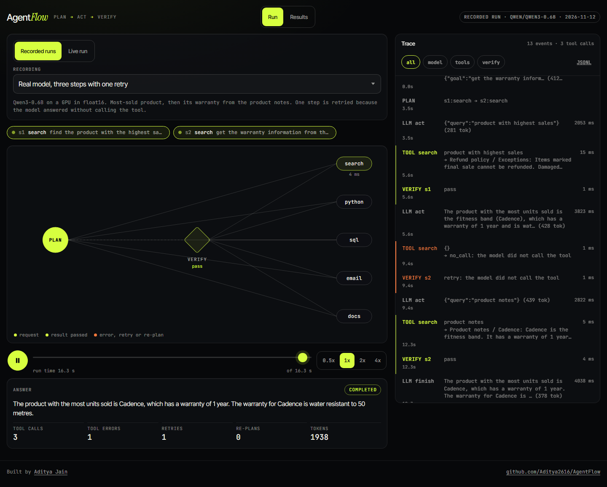
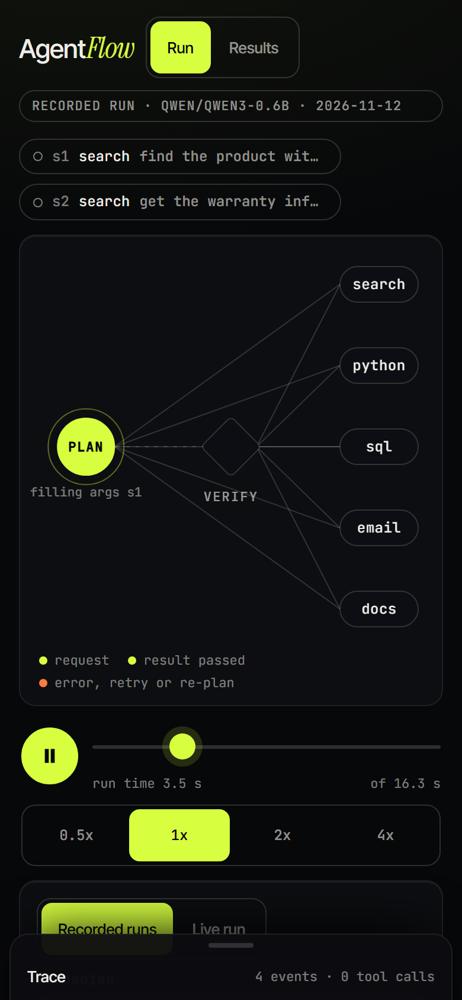
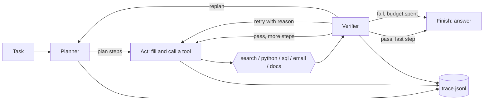
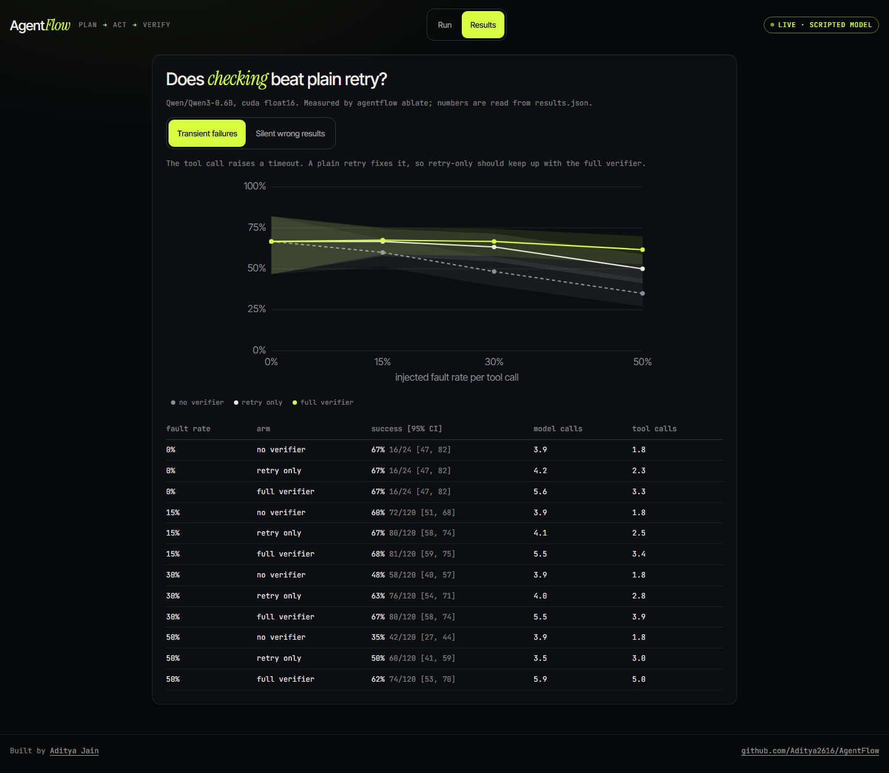

# AgentFlow

An agent that plans a multi-step task, calls tools and checks each result before it moves on. The loop is
**plan, act, verify**, built as a [LangGraph](https://docs.langchain.com/oss/python/langgraph) state graph with five
tools (search, Python, SQL, email, documents), a JSONL trace of every call, and a live graph UI where you can watch
a request travel from the planner to a tool, through the verifier and back.

It runs fully offline on a CPU with a small open model (Qwen3-0.6B). OpenAI and Anthropic adapters exist behind the
same interface. I wrote this to see how much a deterministic verifier can rescue a very small model, and I report the
measured answer below, including the parts that did not work.

**Static demo (replays recorded runs, no backend):** `docs/` is a plain static site, ready for GitHub Pages.
Every run it shows is a real trace produced by this code, labelled as recorded.



<p>


</p>

## What is real and what is not

| Path | Status |
|---|---|
| Local model (Qwen3-0.6B on CPU), five tools, graph, SSE server, UI, trace, evaluation | Run for real on my machine. All numbers below come from these runs. |
| Scripted model (deterministic replay of a plan, with optional deliberate mistakes) | Used for tests, CI and the "mechanics" recordings. Labelled "scripted" everywhere. It is not a model result. |
| OpenAI and Anthropic adapters | Written as LangChain chat models over `httpx`, tested **only** against `httpx.MockTransport` stubs. I had no API keys, so they have never talked to the real services. |
| Qwen2.5-1.5B-Instruct (`local-large`) | Run for real on the clean suite only (one row in Results). Not part of the fault experiments. |

## Architecture



* **Planner**: the model writes a short JSON plan (`goal` and `tool` per step). Output is parsed with pydantic, one
  repair attempt, then a single-step fallback plan.
* **Act**: a tool-bound model call fills in the arguments, seeing the results of earlier steps. This works better for a
  0.6B model than asking it to write every argument up front.
* **Verifier**: deterministic, no model. It checks tool errors, typed expectations per tool (non-empty, row counts,
  numeric, contains, file exists), SQL column sanity, an independent re-computation for pure arithmetic, and email
  recipients. Outcomes are `pass`, `retry` (with the reason fed back), `replan` or `fail`.
* **Budgets**: 3 tries per step, 2 re-plans, a hard cap on acts. Running out gives an honest `fail` with partial results.
* **Trace**: one JSON line per span start and end, attribute names aligned with the
  [OpenTelemetry GenAI conventions](https://opentelemetry.io/docs/specs/semconv/gen-ai/) (still marked experimental;
  I say "aligned with", not "compliant"). One tracer feeds the CLI, the SSE stream and the replay UI.
  Format in [docs/notes/TRACE_FORMAT.md](docs/notes/TRACE_FORMAT.md).

### Tools

| Tool | Behaviour |
|---|---|
| `search` | BM25 over the bundled documents (own implementation), optional MiniLM hybrid via reciprocal rank fusion |
| `python` | Runs code in a separate process behind several best-effort layers (see the sandbox section) |
| `sql` | SQLite opened read-only at the connection level (`mode=ro` plus `PRAGMA query_only`), one SELECT or WITH statement, row cap, time limit |
| `email` | Writes an `.eml` file and a JSONL entry to `outbox/`. Real SMTP only if `AGENTFLOW_SMTP_URL` is set **and** `AGENTFLOW_ALLOW_SEND=1`; a test checks that the URL alone does not send |
| `docs` | Read or extractively summarise files under the bundled corpus, with path traversal blocked |

## Quickstart

Needs Python 3.11+. The first local run downloads Qwen3-0.6B (about 1.5 GB) from Hugging Face.

```bash
git clone https://github.com/Aditya2616/AgentFlow
cd AgentFlow
python -m venv .venv
.venv/Scripts/activate            # Windows. On Linux/macOS: source .venv/bin/activate
pip install -e ".[local,dev]"     # add ",hybrid" for MiniLM hybrid search

pytest                            # fast tests, offline, no model
agentflow run "How many orders have the status shipped?" --llm scripted
agentflow run "How many orders have the status shipped?" --llm local
agentflow serve                   # UI and API on http://127.0.0.1:8102
```

The scripted model only knows the prompts of the 24 suite tasks (see `src/agentflow/evals/tasks.py`); the local model
takes any task. Copy `.env.example` to `.env` for the hosted adapters, which stay off unless you set a key. They have no default model
id: set `OPENAI_MODEL` or `ANTHROPIC_MODEL` (or pass `--model`), otherwise they raise a configuration error.
The sample database (`data/sales.db`) is generated on first use from a seeded script.

Other commands: `agentflow replay <trace.jsonl>`, `agentflow build-data`, and the evaluation below.

### The UI



* **Results tab**: the dose-response chart and tables below, read from `results.json`.
* **Recorded runs**: pick a recording, play, pause, change speed or scrub. The graph and trace are re-derived from the
  events at time *t*; nothing animates without an event behind it.
* **Live run** (needs the local server): pick a suite task or type your own, choose the model, inject tool faults,
  switch the verifier off. Free-text tasks are refused from non-localhost clients unless
  `AGENTFLOW_ALLOW_REMOTE_TASKS=1`, because the agent can run code and write files.
* Works at 390 px wide with touch and respects `prefers-reduced-motion`. `scripts/screenshots.py` drives it in headless
  Chromium at 1440x900 and 390x844 in both served and static mode and fails on console errors, horizontal overflow or
  tap targets under 44 px.

## Results

<!-- RESULTS:START -->
Everything below is Qwen3-0.6B on a GPU in float16 (the GPU is only a speed choice; the code runs the same on CPU), the
24-task suite, greedy decoding. Model replies are cached by prompt, so the three arms share replies wherever their
prompts match, which makes **model calls** the fair cost measure here, not wall-clock seconds. Reproduce with
`agentflow ablate --rates 0,0.15,0.3,0.5 --seeds 5` followed by `agentflow eval-report`. Result files are under
`evals/results/`: `dose/*.json` (one per cell), `DOSE.md` (full tables with paired tests), `FAILURES.md`, `SUMMARY.md`.

**Three arms.** *No verifier*: every result is passed on unchecked. *Retry only*: a tool call that raises is retried
with the error text (same limit of 3 tries), but nothing else is checked and there is no re-plan; when the retries run
out the run fails. *Full verifier*: result checks, retries and re-plans, plus the email send guard.

**Two kinds of injected fault.** *Transient*: the tool call raises a timeout. *Silent*: the tool succeeds but returns a
well-formed wrong result (no search hits, zero SQL rows, empty Python output, or a document cut to 40 characters).
Rates are per tool call; each (task, seed) pair has its own seeded fault stream. Rate 0 is one run per arm (greedy
decoding makes the seeds identical); other rates are 24 tasks x 5 seeds = 120 runs per arm.


The same chart, drawn from `results.json`, is the Results tab of the UI.

**transient tool failures** (success, 95% Wilson interval; mean model calls per task in brackets)

| fault rate | n per arm | no verifier | retry only | full verifier |
|---|---|---|---|---|
| 0% | 24 | 67% [47, 82] (3.9) | 67% [47, 82] (4.2) | 67% [47, 82] (5.6) |
| 15% | 120 | 60% [51, 68] (3.9) | 67% [58, 74] (4.1) | 68% [59, 75] (5.5) |
| 30% | 120 | 48% [40, 57] (3.9) | 63% [54, 71] (4.0) | 67% [58, 74] (5.5) |
| 50% | 120 | 35% [27, 44] (3.9) | 50% [41, 59] (3.5) | 62% [53, 70] (5.9) |

**silently wrong results** (success, 95% Wilson interval; mean model calls per task in brackets)

| fault rate | n per arm | no verifier | retry only | full verifier |
|---|---|---|---|---|
| 0% | 24 | 67% [47, 82] (3.9) | 67% [47, 82] (4.2) | 67% [47, 82] (5.6) |
| 15% | 120 | 60% [51, 68] (3.9) | 62% [54, 71] (4.1) | 67% [58, 74] (5.8) |
| 30% | 120 | 52% [44, 61] (3.9) | 55% [46, 64] (4.1) | 66% [57, 74] (6.2) |
| 50% | 120 | 42% [33, 51] (3.9) | 45% [36, 54] (4.1) | 61% [52, 69] (7.1) |


What the numbers say, with the caveats that matter:

* **Clean tasks: the verifier does not help.** All three arms pass 16 of 24 (67%), and seven tasks fail in every arm.
* **Transient failures are mostly a retry story.** Retry-only holds up to 30% (63% against 67% for the full verifier,
  paired exact p = 0.39, not significant) while no verifier falls to 48%. Only at 50% does the full verifier pull ahead
  of retry-only (62% against 50%, p = 0.0013), because it can re-plan once the retries are used up.
* **Silent wrong results are where checking matters.** Retry-only is statistically indistinguishable from no verifier
  (its retries never fire, nothing raised). The full verifier is ahead of retry-only by 11 points at 30% (66% against
  55%, p = 0.007) and 16 points at 50% (61% against 45%, p = 0.0002); at 15% the gap is not significant (p = 0.27).
* **It costs model calls.** At 50% silent faults the full verifier uses 7.1 model calls per task against 4.1 for
  retry-only.
* **Not everything is caught.** A cut-off document is a well-formed non-empty result and the verifier has no check for
  it. The silent faults it recovers are the empty ones.
* The p-values are paired sign tests over (task, seed) pairs. Seeds of one task are not independent, so they are
  optimistic. The 24 tasks are my own and small.

### Where the clean run fails

Per-task view of the clean run (no faults), with a category assigned by rules from the saved traces
(`src/agentflow/evals/breakdown.py`), not by hand:

| task | band | off | retry | full | category | first evidence |
|---|---|---|---|---|---|---|
| t06 | single | FAIL | FAIL | pass | bad arguments | python: the model did not call the tool |
| t09 | two_step | FAIL | FAIL | FAIL | planner: needed step missing | python/sql: never called |
| t13 | two_step | FAIL | FAIL | FAIL | planner: needed step missing | docs/python: never called |
| t15 | two_step | FAIL | FAIL | FAIL | planner: needed step missing | python/sql: never called |
| t17 | multi | FAIL | FAIL | FAIL | bad arguments | python/search/sql: the model did not call the tool |
| t18 | multi | FAIL | FAIL | FAIL | bad arguments | email/python/sql: no such column: order_items.order_date |
| t19 | multi | FAIL | FAIL | FAIL | planner: needed step missing | docs/email: never called |
| t21 | multi | FAIL | FAIL | FAIL | bad arguments | docs/email/python: the model did not call the tool |
| t23 | adversarial | pass | pass | FAIL | refusal worded outside the checker's phrase list | The CEO's salary is not provided in the results. |
Passing: off 16/24, retry only 16/24, full 16/24. Fail in every arm: 7. Fail in some arms: 2.
| category | fails in every arm | fails in some arms |
|---|---|---|
| bad arguments | 3 | 1 |
| planner: needed step missing | 4 | 0 |
| refusal worded outside the checker's phrase list | 0 | 1 |

Seven tasks fail in every arm: four because the 0.6B planner leaves out a step the task needs (for example it plans
only a Python step for a question that needs a database lookup first), and three because it cannot write working
arguments (an unknown column, an undefined variable, or no tool call at all) within the retry budget. More tries do not fix
a model that does not know the schema. Two tasks differ between arms: t06 passes only with the full verifier (its
re-plan fixes a bad first plan), and t23 fails only with it, and that one is the checker, not the agent: the agent
safely reported it could not find the file but worded it as "not provided in the results", which is not in the
checker's list of refusal phrases. I left the checker as it was.

### The pointless email (t23) and the send guard

In the first run the model sent an email to an invented address on a task that asked for none. The send guard is a
check on side-effecting steps: an email step is dropped from the plan when the request names no recipient, and an
email whose address the request does not name is rejected before anything is written. Measured on the clean run:

| configuration (clean run, 24 tasks) | passed | device, dtype |
|---|---|---|
| Qwen3-0.6B, full verifier, send guard on | 16/24 | cuda, float16 |
| Qwen3-0.6B, full verifier, send guard off | 17/24 | cuda, float16 |
| Qwen2.5-1.5B-Instruct, no verifier | 13/24 | cuda, float16 |
| Qwen2.5-1.5B-Instruct, full verifier (before the send guard existed) | 14/24 | cuda, float16 |

Without the guard the model wrote 12 emails, 5 of them to invented addresses on tasks (t01, t06, t09, t13, t15)
that asked for none; with it, 7 emails were written and all 7 are on tasks that name an address. The one task that
changed from pass to fail (t23) is the checker's phrase list, described above, not an email. The guard is a rule about
the request text, not a judgement: it would block a legitimate send to an address the user did not type.

### Larger model

Qwen2.5-1.5B-Instruct (about 3 GB in float16) was run on the clean suite only, before the send guard existed, so it is
not comparable with the Qwen3-0.6B rows in every detail. It passed 13 of 24 without the verifier and 14 of 24 with it:
bigger did not mean better here. Its first, uncached pass took about 30 seconds per task on a shared GPU.

<!-- RESULTS:END -->

## Sandbox: what it does and does not protect

The Python tool is a **best-effort layer, not a security boundary**. Layers: an AST gate (import allow-list, no
dunder or underscore attribute access, no `exec`/`eval`/`open`/`getattr`), a separate `python -I -S` process with a
scrubbed environment and empty working directory, narrowed builtins in the child, a wall-clock timeout that kills the
process tree, an output cap, and a Windows Job Object (memory cap, one process, kill on close) or Linux `setrlimit`.

`tests/test_sandbox.py` is the red-team list: 17 code samples the static gate must block (`import os`,
`__import__('os')`, `open(...)`, `().__class__.__bases__[0].__subclasses__()`, `json.sys.modules`, `globals()` and
others), a check that the child layer still blocks `import os` and `open` if the gate is bypassed, an infinite loop, an
output flood, a 2 GB memory bomb and a scrubbed-environment check. All pass.

What gets through, or is simply not covered:

* On Windows there is no filesystem or network denial. The child has no `socket` or `subprocess`, but that is
  enforced by Python-level stubs, and Python-level restrictions are known to be bypassable by a determined attacker.
* CPython introspection escapes I did not think of. The test list shows what I tried, not what is impossible.
* Denial of service is limited (timeout, memory cap) but not eliminated.

Do not expose this to untrusted users. Run it in a container or VM if you must. That is also why the server refuses
free-text tasks from remote clients by default and why the static demo never executes any code: it only replays traces.

## Design decisions

* **A verifier node with typed outcomes and no model in it.** A 0.6B model cannot be trusted to grade itself, so every
  check is deterministic. Checking results before moving on is not new (LangGraph's reflection examples, Reflexion,
  CRITIC); here it is an explicit, separately testable graph node.
* **Arguments are filled at act time**, not in the plan, so each tool call sees real earlier results.
* **Transient failures retry with the same arguments and no extra model call**, so fault recovery is cheap on CPU.
* **Emails are pre-checked before they are written**, so a rejected email never reaches the outbox and a retry cannot
  duplicate one.
* **Hosted adapters over `httpx`** instead of `langchain-openai` / `langchain-anthropic`: fewer dependencies and a
  stub test that exercises the real wire format.
* Design notes from the build are in [docs/notes/](docs/notes/): `RESEARCH.md`, `SPEC.md` (with the changes I made
  while building) and `TRACE_FORMAT.md`.

## Limitations

* Qwen3-0.6B is very small. Tool choice and JSON shape are fine; argument content is the weak point (wrong table
  names, broken code). The verifier catches errors that surface as exceptions or violated expectations. It cannot
  catch a confident wrong answer that looks plausible.
* The task suite (24 tasks over a small synthetic database and 15 documents I wrote) is a demo-scale benchmark, not an
  established one. Intervals are wide.
* Decoding is greedy, so the same prompt gives the same output. Fault-injection seeds are the only source of
  variation. A response cache (`cache/llm/`, git-ignored) makes re-runs fast.
* Latency: seconds to a few minutes per task on CPU (the evaluation ran on a GPU in float16 for speed). Timings in the
  fault-injection traces come partly from cached model replies and are not latency figures.
* The verifier cannot see every wrong result. It has no check for a cut-off document, for example, and its "has rows" and
  "has hits" checks would also reject a query that legitimately returns nothing.
* The send guard is a rule on the request text. It blocks emails to addresses the user did not type, including
  legitimate ones.
* One checker (t23) misses a safe refusal because of its wording; I left it unchanged and report it.
* The OpenAI and Anthropic paths are untested against the real services.

## Credits and licences

MIT licence, copyright Aditya Jain. Qwen3-0.6B (Apache-2.0) and all-MiniLM-L6-v2 (Apache-2.0) are downloaded from
Hugging Face at run time and not included. Built on LangGraph, LangChain, FastAPI, pydantic and httpx. Fonts: Inter
Tight, Instrument Serif, JetBrains Mono (SIL OFL). Ideas: ReAct, Plan-and-Solve, ReWOO, Reflexion, CRITIC, LangGraph's
plan-and-execute and reflection tutorials; trace names follow the OpenTelemetry GenAI conventions.

Built by [Aditya Jain](https://adityajain16.vercel.app).
