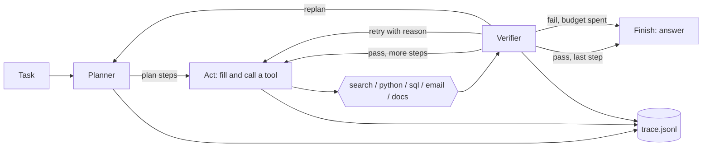

# AgentFlow

An agent that plans a multi-step task, calls tools and checks each result before it moves on. The loop is
**plan, act, verify**, built as a [LangGraph](https://docs.langchain.com/oss/python/langgraph) state graph with five
tools (search, Python, SQL, email, documents), a JSONL trace of every call, and a live graph UI where you can watch
a request travel from the planner to a tool, through the verifier and back.

It runs fully offline on a CPU with a small open model (Qwen3-0.6B). OpenAI and Anthropic adapters exist behind the
same interface. I wrote this to see how much a deterministic verifier can rescue a very small model, and I report the
measured answer below, including the parts that did not work.

**Static demo (replays recorded runs, no backend):** `docs/` is a plain static site, ready for GitHub Pages.
Every run it shows is a real trace produced by this code, labelled as recorded.


<p>


</p>

## What is real and what is not

| Path | Status |
|---|---|
| Local model (Qwen3-0.6B on CPU), five tools, graph, SSE server, UI, trace, evaluation | Run for real on my machine. All numbers below come from these runs. |
| Scripted model (deterministic replay of a plan, with optional deliberate mistakes) | Used for tests, CI and the "mechanics" recordings. Labelled "scripted" everywhere. It is not a model result. |
| OpenAI and Anthropic adapters | Written as LangChain chat models over `httpx`, tested **only** against `httpx.MockTransport` stubs. I had no API keys, so they have never talked to the real services. |
| Qwen2.5-1.5B-Instruct (`local-large`) | Optional configuration. The Results section says whether it was run. |

## Architecture



* **Planner**: the model writes a short JSON plan (`goal` and `tool` per step). Output is parsed with pydantic, one
  repair attempt, then a single-step fallback plan.
* **Act**: a tool-bound model call fills in the arguments, seeing the results of earlier steps. This works better for a
  0.6B model than asking it to write every argument up front.
* **Verifier**: deterministic, no model. It checks tool errors, typed expectations per tool (non-empty, row counts,
  numeric, contains, file exists), SQL column sanity, an independent re-computation for pure arithmetic, and email
  recipients. Outcomes are `pass`, `retry` (with the reason fed back), `replan` or `fail`.
* **Budgets**: 3 tries per step, 2 re-plans, a hard cap on acts. Running out gives an honest `fail` with partial results.
* **Trace**: one JSON line per span start and end, attribute names aligned with the
  [OpenTelemetry GenAI conventions](https://opentelemetry.io/docs/specs/semconv/gen-ai/) (still marked experimental;
  I say "aligned with", not "compliant"). One tracer feeds the CLI, the SSE stream and the replay UI.
  Format in [docs/notes/TRACE_FORMAT.md](docs/notes/TRACE_FORMAT.md).

### Tools

| Tool | Behaviour |
|---|---|
| `search` | BM25 over the bundled documents (own implementation), optional MiniLM hybrid via reciprocal rank fusion |
| `python` | Runs code in a separate process behind several best-effort layers (see the sandbox section) |
| `sql` | SQLite opened read-only at the connection level (`mode=ro` plus `PRAGMA query_only`), one SELECT or WITH statement, row cap, time limit |
| `email` | Writes an `.eml` file and a JSONL entry to `outbox/`. Real SMTP only if `AGENTFLOW_SMTP_URL` is set **and** `AGENTFLOW_ALLOW_SEND=1`; a test checks that the URL alone does not send |
| `docs` | Read or extractively summarise files under the bundled corpus, with path traversal blocked |

## Quickstart

Needs Python 3.11+. The first local run downloads Qwen3-0.6B (about 1.5 GB) from Hugging Face.

```bash
git clone https://github.com/Aditya2616/AgentFlow
cd AgentFlow
python -m venv .venv
.venv/Scripts/activate            # Windows. On Linux/macOS: source .venv/bin/activate
pip install -e ".[local,dev]"     # add ",hybrid" for MiniLM hybrid search

pytest                            # fast tests, offline, no model
agentflow run "How many orders have the status shipped?" --llm scripted
agentflow run "How many orders have the status shipped?" --llm local
agentflow serve                   # UI and API on http://127.0.0.1:8102
```

The scripted model only knows the prompts of the 24 suite tasks (see `src/agentflow/evals/tasks.py`); the local model
takes any task. Copy `.env.example` to `.env` for the hosted adapters, which stay off unless you set a key.
The sample database (`data/sales.db`) is generated on first use from a seeded script.

Other commands: `agentflow replay <trace.jsonl>`, `agentflow build-data`, and the evaluation below.

### The UI

* **Recorded runs**: pick a recording, play, pause, change speed or scrub. The graph and trace are re-derived from the
  events at time *t*; nothing animates without an event behind it.
* **Live run** (needs the local server): pick a suite task or type your own, choose the model, inject tool faults,
  switch the verifier off. Free-text tasks are refused from non-localhost clients unless
  `AGENTFLOW_ALLOW_REMOTE_TASKS=1`, because the agent can run code and write files.
* Works at 390 px wide with touch and respects `prefers-reduced-motion`. `scripts/screenshots.py` drives it in headless
  Chromium at 1440x900 and 390x844 in both served and static mode and fails on console errors, horizontal overflow or
  tap targets under 44 px.

## Results

<!-- RESULTS -->

## Sandbox: what it does and does not protect

The Python tool is a **best-effort layer, not a security boundary**. Layers: an AST gate (import allow-list, no
dunder or underscore attribute access, no `exec`/`eval`/`open`/`getattr`), a separate `python -I -S` process with a
scrubbed environment and empty working directory, narrowed builtins in the child, a wall-clock timeout that kills the
process tree, an output cap, and a Windows Job Object (memory cap, one process, kill on close) or Linux `setrlimit`.

`tests/test_sandbox.py` is the red-team list: 17 code samples the static gate must block (`import os`,
`__import__('os')`, `open(...)`, `().__class__.__bases__[0].__subclasses__()`, `json.sys.modules`, `globals()` and
others), a check that the child layer still blocks `import os` and `open` if the gate is bypassed, an infinite loop, an
output flood, a 2 GB memory bomb and a scrubbed-environment check. All pass.

What gets through, or is simply not covered:

* On Windows there is no filesystem or network denial. The child has no `socket` or `subprocess`, but that is
  enforced by Python-level stubs, and Python-level restrictions are known to be bypassable by a determined attacker.
* CPython introspection escapes I did not think of. The test list shows what I tried, not what is impossible.
* Denial of service is limited (timeout, memory cap) but not eliminated.

Do not expose this to untrusted users. Run it in a container or VM if you must. That is also why the server refuses
free-text tasks from remote clients by default and why the static demo never executes any code: it only replays traces.

## Design decisions

* **A verifier node with typed outcomes and no model in it.** A 0.6B model cannot be trusted to grade itself, so every
  check is deterministic. Checking results before moving on is not new (LangGraph's reflection examples, Reflexion,
  CRITIC); here it is an explicit, separately testable graph node.
* **Arguments are filled at act time**, not in the plan, so each tool call sees real earlier results.
* **Transient failures retry with the same arguments and no extra model call**, so fault recovery is cheap on CPU.
* **Emails are pre-checked before they are written**, so a rejected email never reaches the outbox and a retry cannot
  duplicate one.
* **Hosted adapters over `httpx`** instead of `langchain-openai` / `langchain-anthropic`: fewer dependencies and a
  stub test that exercises the real wire format.
* Design notes from the build are in [docs/notes/](docs/notes/): `RESEARCH.md`, `SPEC.md` (with the changes I made
  while building) and `TRACE_FORMAT.md`.

## Limitations

* Qwen3-0.6B is very small. Tool choice and JSON shape are fine; argument content is the weak point (wrong table
  names, broken code). The verifier catches errors that surface as exceptions or violated expectations. It cannot
  catch a confident wrong answer that looks plausible.
* The task suite (24 tasks over a small synthetic database and 15 documents I wrote) is a demo-scale benchmark, not an
  established one. Intervals are wide.
* Decoding is greedy, so the same prompt gives the same output. Fault-injection seeds are the only source of
  variation. A response cache (`cache/llm/`, git-ignored) makes re-runs fast.
* Latency is CPU-bound: seconds to several minutes per task.
* The OpenAI and Anthropic paths are untested against the real services.

## Credits and licences

MIT licence, copyright Aditya Jain. Qwen3-0.6B (Apache-2.0) and all-MiniLM-L6-v2 (Apache-2.0) are downloaded from
Hugging Face at run time and not included. Built on LangGraph, LangChain, FastAPI, pydantic and httpx. Fonts: Inter
Tight, Instrument Serif, JetBrains Mono (SIL OFL). Ideas: ReAct, Plan-and-Solve, ReWOO, Reflexion, CRITIC, LangGraph's
plan-and-execute and reflection tutorials; trace names follow the OpenTelemetry GenAI conventions.

Built by [Aditya Jain](https://adityajain16.vercel.app).
