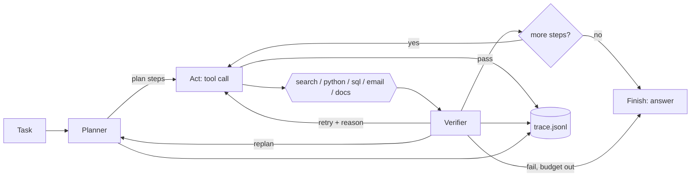

# AgentFlow: spec

Repo `AgentFlow`, package `agentflow`, local port 8102. MIT, copyright Aditya Jain.

## 1. Promise (from the site)

An agent that plans a multi-step task, calls tools and checks each result. Plan -> act -> verify. Python, LangChain/LangGraph, OpenAI/Anthropic adapters. Five tools: search, Python, SQL, email, documents. Live UI where packets travel planner -> tool -> verifier -> back while the trace log records every call.

## 2. Architecture



LangGraph `StateGraph` with nodes `plan`, `act`, `verify`, `finish`. Routing by `Command(goto=...)` from `verify`. State: `task`, `plan: list[Step]`, `cursor`, `results: dict[step_id, Observation]`, `attempts`, `replans`, `budget`. Trace events are emitted from inside nodes through `get_stream_writer()` and also appended to the JSONL file, so one source feeds CLI, SSE and replay.

**Step** = `{id, goal, tool, args (may reference $sN.field), expect}`. `expect` is a typed expectation the verifier can check without an LLM: `nonempty`, `rows(min,max)`, `numeric(approx|range)`, `contains(text)`, `no_error`, `file_exists`, `outbox_count`, `matches(regex)`. The planner proposes `expect` per step with a default per tool, so a weak planner still gets sensible checks.

**Verifier** returns `Verdict{outcome: pass|retry|replan|fail, reason, checks[]}`:
1. Tool-level error (exception, SQL error, Python traceback, timeout) -> `retry` with the error text, up to `max_attempts` (2); then `replan`.
2. Expectation check fails -> `retry` (arguments probably wrong) then `replan`.
3. Cross-checks, deterministic: SQL results re-run with `EXPLAIN` sanity (columns exist), Python numeric results re-evaluated against an independent `ast`-safe arithmetic evaluator when the step is pure arithmetic, email recipient must be a syntactically valid address, document step must name an existing file.
4. Optional LLM judge (off by default, flag `--llm-verify`); never overrides a deterministic failure.
Budgets: `max_steps` 8, `max_attempts` 2 per step, `max_replans` 2, wall-clock limit. Exhaustion yields an honest `fail` final with partial results.

**Planner**: LLM produces JSON plan; output parsed with pydantic; on parse failure one repair attempt (error fed back), then fallback to a single-step ReAct-style plan. Prompt contains tool catalogue, DB schema, document list, and (on replan) the failed step and reason.

## 3. LLM layer

`LLM` protocol: `generate(messages, tools, *, json_schema=None) -> LLMResult{text, tool_calls, usage}`.
- `LocalHF`: transformers, default `Qwen/Qwen3-0.6B`, non-thinking, greedy, fp32/bf16 chosen by a quick benchmark, `<tool_call>` parsing with JSON repair.
- `ScriptedLLM`: deterministic; replays per-task scripts (including scripted mistakes to exercise retry/replan). Used by unit tests, CI and the fault-injection suite.
- `OpenAIChat`, `AnthropicMessages`: httpx, env-selected (`AGENTFLOW_LLM=local|scripted|openai|anthropic`, `OPENAI_API_KEY`, `ANTHROPIC_API_KEY`, model names via env). Tested only against `httpx.MockTransport` stubs; README says so.

## 4. Tools (LangChain `StructuredTool`, pydantic arg models)

| Tool | Behaviour | Safety |
|---|---|---|
| `search` | BM25 (+ optional MiniLM RRF) over `data/corpus/`; returns top-k chunks with doc id and score | read-only |
| `python` | sandbox as in RESEARCH 4 | see limits; documented non-boundary |
| `sql` | SQLite opened `mode=ro` + `PRAGMA query_only`, single statement, SELECT/WITH only, row cap 200, 2 s progress-handler timeout | read-only |
| `email` | writes `.eml` + JSONL entry to `outbox/`; real SMTP only if `AGENTFLOW_SMTP_URL` set AND `--allow-send` passed; recipient allow-list option | never sends by default |
| `docs` | `read` / `summarise` files under `data/corpus` and `data/files`; path traversal blocked; summarise is extractive (TextRank-style) so it works offline | read-only, jailed path |

## 5. Trace

`runs/<run_id>/trace.jsonl`, one event per line: `{trace_id, span_id, parent_span_id, ts, event: start|end|log, name, kind, attributes{gen_ai.operation.name, gen_ai.tool.name, gen_ai.tool.call.id, gen_ai.request.model, gen_ai.usage.*, agentflow.step_id, agentflow.verdict, agentflow.attempt, ...}, status}`. Spans: `invoke_agent` root; children `chat` (planner/LLM calls), `execute_tool`, and `agentflow.verify`. Schema in `docs/TRACE_FORMAT.md`; pydantic model validates every line in tests. Optional `agentflow trace export-otlp`.

## 6. Layout

```
AgentFlow/
  pyproject.toml  requirements.txt  .env.example  LICENSE  README.md  RESEARCH.md  SPEC.md
  src/agentflow/
    cli.py  config.py
    graph.py  state.py  planner.py  verifier.py  expectations.py
    llm/{base,local_hf,scripted,openai_chat,anthropic_chat}.py
    tools/{registry,search,python_sandbox,sql,email,docs}.py
    tracing/{events,writer,otlp}.py
    data/{corpus/*.md, build_db.py}
    server/{app.py,models.py,runs.py}        # FastAPI, SSE, run registry
    evals/{tasks.yaml,run_suite.py,report.py,faults.py}
  tests/  (unit, sandbox red-team, adapters with stubs, graph with ScriptedLLM, server SSE; slow: real model)
  web/    index.html app.js (ES modules) style.css graph.js trace.js
  docs/   static copy of web/ + recordings/*.jsonl + assets/ screenshots  (GitHub Pages)
  scripts/ record_runs.py  screenshots.py  build_docs.py
  .github/workflows/ci.yml
```

## 7. Service

FastAPI: `GET /health`, `GET /api/tools`, `GET /api/tasks`, `POST /api/runs {task, llm, options}` -> `{run_id}`, `GET /api/runs/{id}/events` (SSE, supports `Last-Event-ID` resume), `GET /api/runs` , `GET /api/runs/{id}/trace` (JSONL). One run at a time per worker with queueing (local model is CPU-bound). Static UI served at `/`.

## 8. CLI

`agentflow run "task" --llm scripted|local|openai|anthropic`, `agentflow serve --port 8102`, `agentflow eval --suite default --llm ... --faults`, `agentflow replay runs/<id>/trace.jsonl`, `agentflow build-data`.

## 9. UI concept (real version of the `agent` scene)

Single page, dark void, lime accent, orange for failures/retries.
- **Left/centre: live graph (SVG + GSAP, canvas for packet glow if needed).** Planner node on the left, five tool nodes on an arc in the middle (search, python, sql, email, docs), verifier node on the right, task in / answer out at the ends. Each real `execute_tool` start event launches a packet along planner -> tool; its end event sends the packet tool -> verifier; the verdict sends it back (lime on pass, orange on retry/replan, which also flashes the planner). Node state (idle/active/failed) is derived from events only. No packets without events.
- **Right: trace log**, newest at bottom, mono labels, one row per event with latency, tool name, truncated args/result, verdict. Click a row to open full JSON and to highlight its path on the graph. Filter chips by event kind.
- **Top: plan strip** showing steps with state chips (pending/running/passed/retried/failed); replans visibly replace the strip.
- **Controls:** task picker (suite tasks + free text), LLM selector (local / scripted), Run; **Replay** of recorded runs with play/pause, speed 0.5x-4x and a scrubber that re-derives graph state at time t. Badge: "LIVE (local model)" vs "RECORDED RUN" with date and model.
- **Demo mode (docs/):** no backend; loads `recordings/*.jsonl` from real runs (local Qwen3-0.6B runs plus scripted fault-injection runs, labelled) through the same replay engine.
- **Phone (390 px):** graph on top (scaled viewBox), trace log as a bottom sheet with 44 px rows, no hover dependence, controls in a sticky bar. `prefers-reduced-motion`: packets snap instead of travelling. Animate transform/opacity only, pause when off screen, DPR cap 2.
- Footer: "Built by Aditya Jain" + repo link.

## 10. Evaluation (numbers must come from runs)

`evals/tasks.yaml`: ~24 tasks in four bands: single-tool (8), two-step with data passing (8, e.g. SQL then Python computation, search then email), multi-tool (5), unanswerable/adversarial (3, e.g. missing file, forbidden SQL `DROP`, import of `os`: success = graceful refusal/fail without side effects). Each has a deterministic checker on final answer and side effects (outbox contents, no DB change).
Reported: task success rate, steps, tool calls, retries, replans, wall time, per configuration:
1. ScriptedLLM with scripted mistakes: shows verifier recovery mechanics (expected ceiling, labelled as such, not a model result).
2. Qwen3-0.6B real, verifier ON vs verifier OFF (ablation: same loop, verdicts forced to pass). This is the headline measured result, whatever it turns out to be.
3. Qwen3-0.6B + injected tool faults (random transient errors) with and without retry.
Each with N runs (seeded, greedy so deterministic; fault seeds vary). Command: `agentflow eval --suite default --llm local --ablate-verifier`. Results saved to `evals/results/*.json` and rendered in README.

Also: retrieval recall@3 BM25 vs hybrid on ~30 labelled queries.

## 11. Test plan

Fast/offline (CI): expectations and verifier verdict matrix; planner JSON parse/repair; graph routing with ScriptedLLM (pass, retry, replan, budget exhaustion, step reference resolution); each tool (SQL read-only enforcement incl. injection attempts, docs path traversal, email outbox and SMTP gating, BM25 ranking, sandbox red-team list with per-platform expectations); trace schema validity and span nesting; OpenAI/Anthropic adapters via `httpx.MockTransport` (request body, tool-call parsing, error mapping); FastAPI health, run creation, SSE ordering, resume; CLI smoke. Slow (`-m slow`): real Qwen3-0.6B end to end on 3 tasks; MiniLM hybrid search; Playwright UI check (separate script, not CI).

## 12. Definition of done

- Fresh-clone quickstart works in a clean venv; `pytest` and `ruff check` pass; CI workflow present.
- Real Qwen3-0.6B run completes tasks live in the UI via SSE; graph and trace match the JSONL exactly.
- Static `docs/` demo replays real recordings via a plain static server; desktop 1440x900 and phone 390x844 screenshots reviewed, zero console errors, no horizontal scroll.
- Eval numbers in README come from `agentflow eval` runs committed under `evals/results/`.
- README states plainly: which paths ran for real (local model, tools, SSE), which are stub-tested (OpenAI/Anthropic), sandbox limits, small-model limits.
- No AI-assistance mentions anywhere; commits as Aditya2616; clean `git status`; no weights committed.

## 13. Risks

1. 0.6B planner may produce poor multi-step plans (measured: argument content is weak). Mitigation: schema-in-prompt, default `expect` per tool, repair/fallback, verifier-driven retry; report honest success rates. If too low, offer Qwen2.5-1.5B-Instruct as optional (3.1 GB, over budget, user-initiated download).
2. CPU latency: ~9 tok/s means a 4-step run takes roughly 30-90 s. Keep prompts short, cache KV prefix for tool catalogue if cheap, stream status events during LLM calls so the UI is never idle.
3. Sandbox on Windows is not a security boundary (no network/filesystem denial). Documented, red-team tested, gated by AST allow-list.
4. OTel GenAI conventions are unstable; aligned names pinned and labelled.
5. LangGraph 1.x API drift: pin `langgraph>=1.1,<2`.

## 14. Decisions needed from the manager

1. Default local model: Qwen3-0.6B (1.5 GB, measured) acceptable, or allow one 3 GB-class download (Qwen2.5-1.5B) for a better "real" demo?
2. OK to skip `langchain-openai` / `langchain-anthropic` and write httpx adapters (fewer deps, stub-testable)?
3. OK that the Windows sandbox is explicitly documented as best-effort (CI on Linux adds rlimits)?
